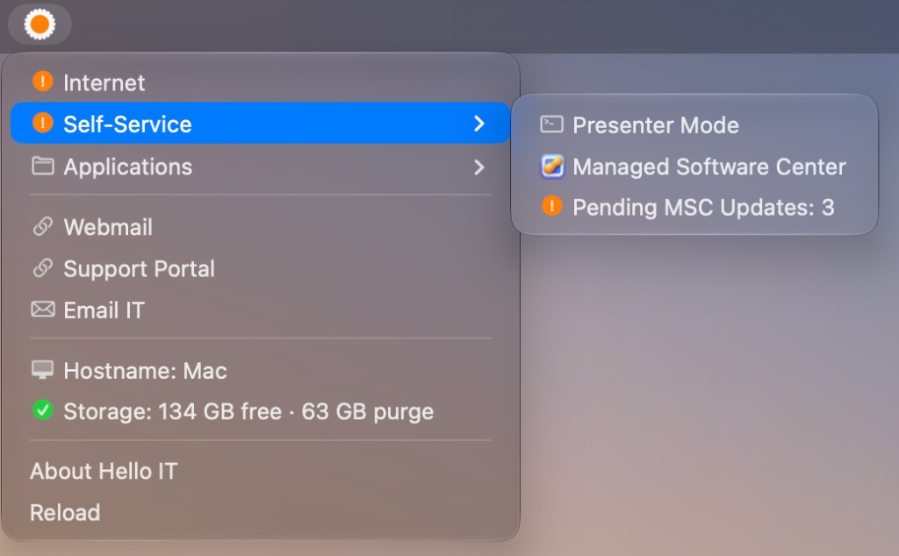

# Hello-IT

Hello-IT is a menu-bar helper fully configurable by IT to provide a self-service menu. Each item can:

* show the state of a service
* show local system information
* run a command
* open an app or a resource

Releases: [GitHub Releases](https://github.com/ygini/Hello-IT/releases)  
Docs: [Wiki](https://github.com/ygini/Hello-IT/wiki)

## What’s new in 1.7.0

This line builds on Yoann’s 1.7 modernization (`os_log`, dark mode, NSURLSession packaging cleanups) and adds:

* **Configurator Mode** — edit the menu tree in the app, Apply & Reload, export plist / `.mobileconfig` / bash installer (⇧⌥-click the status item to unlock; fleet can disable)
* **Built-in plugins** — System info, Munki, Send email, About (no CustomScripts required for common items)
* **Alerts / thresholds / notifications** — warn/error thresholds and optional banners for stateful items; optional Command completion notify
* **HTTP test failover** — optional secondary host when the primary URL cannot connect (Warning if ping works but HTTP failed; not OK)
* **Script network change** — optional `settings.network` so scripts re-run with subcommand `network` when connectivity changes
* **Deployment hardening** — `notarytool`, universal builds, min macOS **12.0**, safer default for writable scripts

See:

* [Docs/deployment-hardening.md](Docs/deployment-hardening.md) — signing, notarization, MDM
* [Docs/configurator.md](Docs/configurator.md) — Configurator Mode
* [Docs/built-in-plugins.md](Docs/built-in-plugins.md) — System info / Munki / Send email / About
* [example/](example/) — sample prefs (Basic Example uses built-ins; script folders kept for older releases / custom items)

AutoPkg: [ygini-recipes](https://github.com/autopkg/ygini-recipes)
